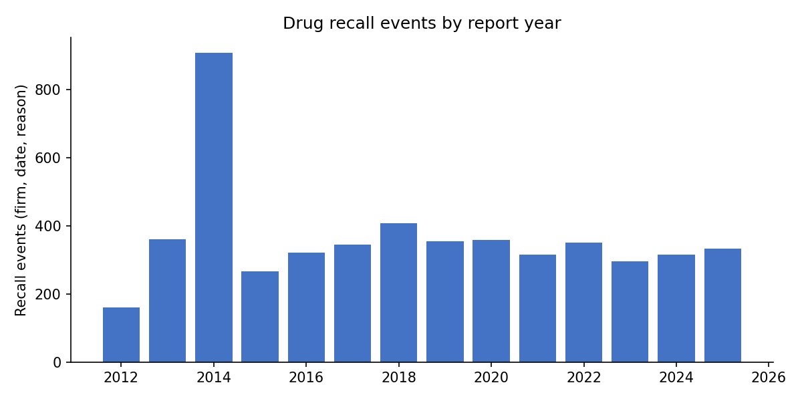
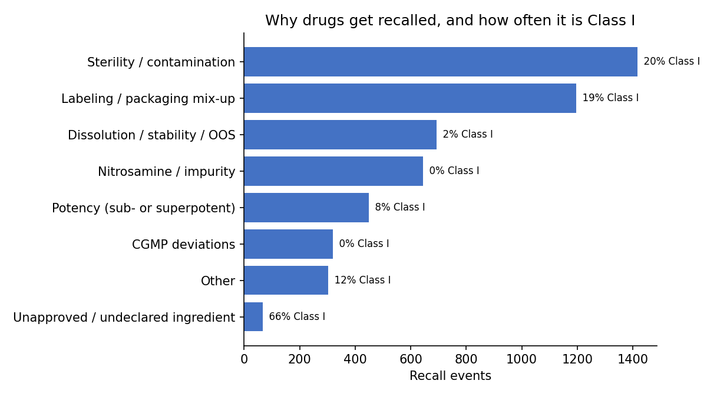

# FDA drug recalls, 2012 to 2025: why drugs get pulled and how serious it is

I pulled every drug recall record from the FDA enforcement reports on openFDA and looked at three things. What reasons come up most, how serious the recalls are (Class I is the worst, Class III the mildest), and whether the wording of the reason alone can predict a Class I recall.

I'm a pharmacist, so I've handled recall notices on the shelf. I wanted the picture across the whole system.

## Data

openFDA drug enforcement API (https://open.fda.gov/apis/drug/enforcement/). `src/fetch.py` downloads 17,373 product-level records with report dates from 2012 to 2025. The raw file (8 MB) is not stored here. Run the script to rebuild it.

One recall often covers many products and lots, so product records overcount. I also group them into "events": same firm, same report date, same reason. That gives 5,091 events. Class mix: Class II 81%, Class I 10%, Class III 10% of records.

## Results

- Sterility and contamination problems are the biggest reason, 27.8% of events. 20% of those are Class I. Labeling and packaging mix-ups are next at 23.5% (19% Class I).
- Nitrosamine and impurity recalls are 12.6% of events and almost never Class I (0.5%). They got the headlines in 2018 to 2022, but the FDA rated almost all of them Class II.
- Unapproved or undeclared ingredients (sildenafil-type adulteration) are rare, 68 events, but 66% are Class I. These are the most serious per event.
- Dissolution, stability and out-of-specification failures: 13.6% of events, 1.9% Class I.
- Events per year are steady, around 300 to 400 from 2016 to 2025 (2014 stands out at 907 because one repackager, Aidapak Services, accounts for 499 of those events). Product records vary much more with a few large recalls.
- Predicting Class I from the reason text: a logistic regression on words, trained on 2012 to 2022 and tested on 2023 to 2025 events, gets AUC 0.94. A model using only my seven hand-made categories gets 0.76. The words add a lot: "undeclared", "non-sterility", "particulate" and "mix-up" push towards Class I, "cgmp", "lack of assurance", "specification" and "degradation" push towards Class II or III.




## Limits

- Categories come from regular expressions on the reason text, first match wins (order in `src/analyze.py`). A recall that mentions both sterility and labeling lands in sterility. CGMP only shows up when nothing earlier matched, which is why it has 0% Class I.
- Events are my own grouping. Differently worded reasons from the same firm count as separate events, so a single firm can inflate a year (Aidapak in 2014).
- The classifier reads the FDA's own reason text, which is partly written with the classification in mind. High AUC means the text carries the severity, not that I can predict future recalls before the reason is known.
- Records for 2024 and 2025 are fewer than earlier years, and some recent reports may still be added.
- These are recalls the FDA recorded, not all quality problems.

## Run it

```
pip install numpy pandas requests matplotlib
python src/fetch.py
python src/analyze.py
```
